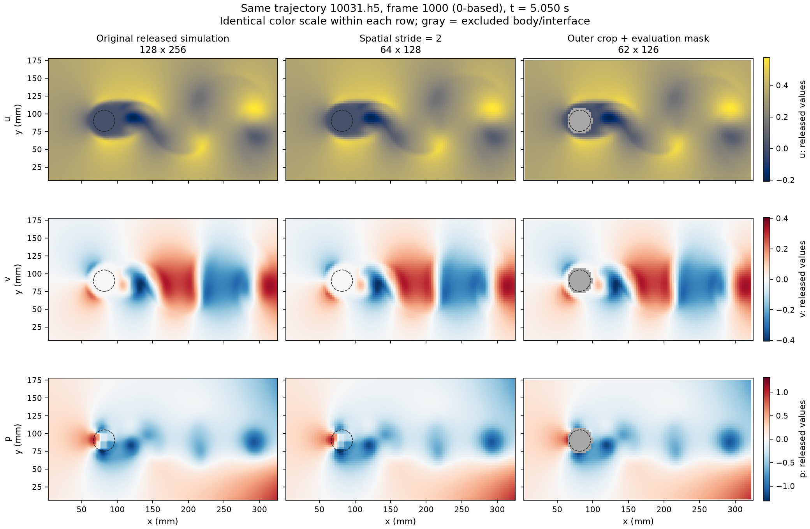

# Cylinder 数据处理与配对轨迹样例

本页介绍阶段2使用的 **RealPDEBench Cylinder numerical** 实验数据，和212公式语料benchmark是两个不同的数据集。

## 配对样例

- 轨迹：`10031.h5`，原始零基帧区间 `[20,60)`，属于本项目 `train_fit` 角色。
- `released_10031_train_window.npz`：原发布数值数组的40帧摘录，`u/v/p` 为 `[40,128,256]`；`x/y` 为原网格坐标，`t` 为原时间。
- `processed_10031_train_window.npz`：完全对应的处理后40帧，`u/v/p` 为 `[40,62,126]`；另有每场 `[40,380]` 的halo、坐标和几何/有效区域mask。
- 前20帧是输入，后20帧是目标。这里只发布一个训练窗口用于格式与处理复核，不是完整3990帧轨迹，不是独立验证/测试集。
- `sample_manifest.json` 保存源数据版本、原Arrow分片哈希、导出文件哈希及逐值一致性检查。

这里“原始数据”指上游 **已发布的 numerical 数组**，不是未经插值或测量处理的原始CFD网格/实验传感器数据，也不是 `real` 分支。NPZ是为了便于阅读的摘录格式，并非上游原Arrow容器；摘录字段值没有改变。

## 与标准发布数据的区别

|内容|上游发布数值数据|本项目阶段2|
|---|---|---|
|来源与版本|RealPDEBench，revision `0ae4426085d250787f96d5456bc0d30ce5f277d2`|同一版本、同一numerical分支|
|空间网格|128×256|先 `[::2,::2]` 得64×128，再裁外圈1格得62×126|
|物理场|u、v、p|三个场全部保留，float32；不随机删除压力|
|时间|每轨迹3990帧，dt=0.005秒|全部时间帧保留，不降采样、不新增时间平滑|
|几何与评分区域|发布数组包含圆柱支撑区域|用圆柱物理几何确定solid，排除圆柱内部及其8邻域1格界面带；共同有效区域7660点|
|空间外圈|包含发布网格边缘|裁掉的64×128外圈另存halo；可见历史上下文可无损重建|
|时序任务|保留上游索引供审计|自定义seen轨迹的分块时间划分；20帧预测紧接的20帧|
|存储|Arrow轨迹分片|NPY目录及mmap读取，角色访问检查，manifest/哈希记录|

`valid_mask`只决定损失/拟合/指标使用哪些点，不把被排除的数组元素删除或改成0。压力保持发布值，没有新增去均值、填补或mask变换。空间取样没有低通抗混叠，因此不能称其为无空间信息损失；“逐值相同”仅指保存的点等于对应原始切片。处理后存储约为原Arrow的25%，主要来自两轴步长2取样，而不是mask。

## 为什么避免在边界上直接拟合

我们的任务重点是从可见时空场识别内区PDE结构。边缘的空间导数依赖单边差分、界外值或另行声明的边界条件；圆柱内部及固液界面也不应和自由流体内区混为同一种局部残差样本。若直接纳入这些点，候选比较可能同时反映方程结构和边界处理差异。

因此采用内区拟合/评分、排除界面邻域，并把需要的历史上下文单独保留。此前与EQGPT的讨论也是把**用内区导数数据拟合方程**作为方法动机；这里不声称原版EQGPT与本项目采用完全相同的裁边格数、Cylinder几何或数据划分。实际参数以本仓库预处理、mask和数值后端代码为准，而不是依据“EQGPT也这么做”推断。

**这个选择不能让外推问题不再需要边界条件。**历史前缀的halo不包含未来边界真值；当前通用隐式后端默认冻结最后可见边界/上下文，还会按导数模板设置额外collar。裁边和mask是数据/评分约定，冻结边界是求解器近似，两者必须区分；边界附近误差及其向内传播仍是外推局限。

为公平比较，EQGPT与U-Net/FNO等baseline允许访问同一64×128可见上下文，预测、损失和指标使用相同62×126有效mask。不能让某方法额外读取未来halo。

## 时序划分与标准索引

不沿用原发布索引直接报告官方benchmark成绩。每条轨迹分为16个约250帧时间块，固定种子525随机分配；全部92条轨迹均在各角色出现，即seen轨迹时间外推，不是未见轨迹泛化。

- `train_fit`：5060窗口；内部reward留出：460窗口；两者为训练池75%。
- 候选选择验证：460窗口；早停验证：460窗口；合计12.5%。
- 最终test：920窗口，占12.5%。
- 每窗40帧，块两端各留20帧，窗口步长40；跨角色窗口无共享帧，有隔离间隔，实际审计最小间隔50帧。
- 归一化统计只取去重后的train_fit可见前20帧。公开训练样例不意味着训练程序可以读取验证/test目标。

因此本项目结果是**自定义seen时序协议下**的比较，不可直接与RealPDEBench官方划分的排行榜数值相混。

## 复核方法与代码

运行 `python verify_samples.py` 可检查原数据取样裁边、halo重建、坐标和时间逐值一致；不需要下载完整数据。导出脚本 `export_reference.py` 记录服务器上的来源路径，需要完整上游Arrow和处理数据才能重新导出。

预处理和验证代码见 [`process_cylinder.py`](../local/stage2_main_v1/prepare/process_cylinder.py)、[`verify_data.py`](../local/stage2_main_v1/prepare/verify_data.py)、[`index_policy.py`](../local/stage2_main_v1/prepare/index_policy.py)；历史数值后端见原实验的 `historical_code`。处理前后图片中的frame1000及frame0/20/40/60是先前审计图，不全属于本次NPZ摘录；图标题已标明时间，不应当成额外可下载帧。

## 来源与许可

来源：[RealPDEBench dataset](https://huggingface.co/datasets/AI4Science-WestlakeU/RealPDEBench)，[上游代码](https://github.com/AI4Science-WestlakeU/RealPDEBench)。本次小样例为原发布数据摘录及其裁剪/取样版本，应遵循上游 **CC BY-NC 4.0**（[许可文本](https://creativecommons.org/licenses/by-nc/4.0/)），非商业使用并保留来源和修改说明；不以本仓库代码许可证替换数据许可。数据处理不表示原作者认可本项目。

## 完整处理后数据集

完整92条轨迹（约34GiB未压缩）独立发布到 [processed-cylinder-v1 Release](https://github.com/xtr1976536/from-tokenizer-to-pde-discovery-2/releases/tag/processed-cylinder-v1)：每轨迹一个 `processed-cylinder-<sim_id>.tar.gz`，另有 `processed-cylinder-metadata.tar.gz` 包含当前manifest、几何、归一化统计、官方索引审计、时间块划分与历史元数据。只发布处理后数据，不重复上传全量原始Arrow数据。

全部93个附件已上传并逐包核验状态、大小和SHA-256；`full_dataset_manifest.json` 列出每个附件及其内部各文件的SHA-256。可用 `python download_processed.py --destination /path/to/data` 逐包下载、解压并验证；只取某一轨迹可加 `--trajectory 10031.h5`，metadata仍会下载。恢复的目录名是 `cylinder_numerical_stage2_v1`。请使用当前manifest确定实际训练/验证/test角色，history内的旧划分只作审计。

完整派生数据继续适用上述RealPDEBench的CC BY-NC 4.0许可、归属和非商业条件；本项目裁剪、空间取样、mask和自定义划分均已在本页注明。
