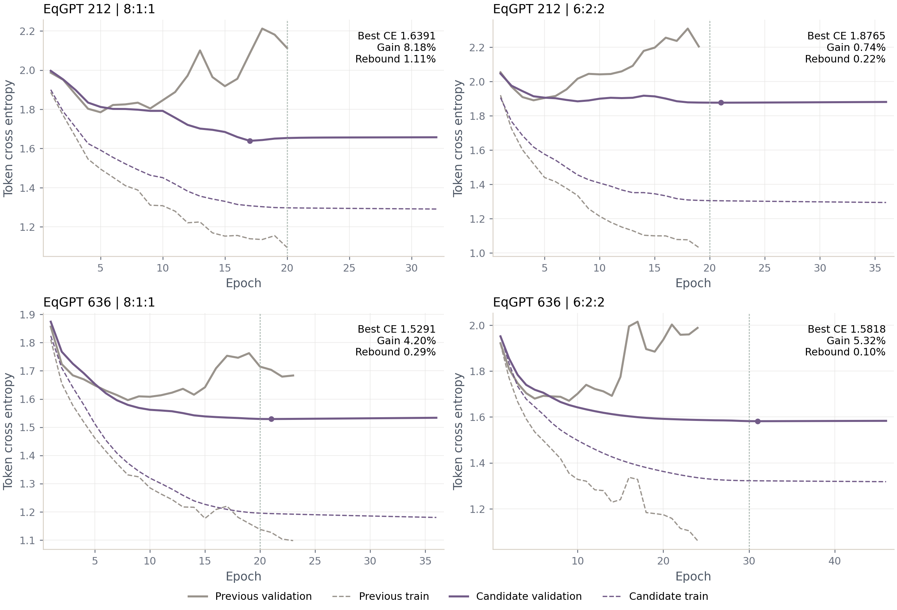

# EqGPT独立调参：76组详细复核

日期2026-11-17。四套语料各18个新策略加1个旧策略，seed525。原始76组training/COMPLETE逐轮核查通过：完成轮数、最低验证CE/最佳epoch吻合，损失有限、候选至少30轮、余弦终点后固定eta_min1e-6、早停参考阈值计数正确。未读取测试数据；本次没有启动新实验、未修改AST队列。

## 当前候选

|规模|划分|LR|矩阵L2|T|最佳CE|较旧策略改善|最佳/停止轮|末轮回升|
|---|---|---:|---:|---:|---:|---:|---|---:|
|212|811|0.0001|0.001|20|1.639091|8.18%|17/32|1.111%|
|212|622|5e-05|0.001|20|1.876473|0.74%|21/36|0.223%|
|636|811|5e-05|0|20|1.529077|4.20%|21/36|0.294%|
|636|622|0.0001|0.001|30|1.581845|5.32%|31/46|0.095%|

这些是seed525验证最好的候选，不是已经多种子确认的最终参数。共同设置Adam、6层、batch128、clip1、minimum_completed_epochs30、patience15、min_delta1e-4、max80、eta_min1e-6；完成T轮后降到最低并保持；真实最低验证检查点独立于有效改善计数保存。

## 逐条件判断

212/811：最佳配置LR1e-4/L2=.001/T20改善8.18%，旧策略停止回升18.39%降到1.11%，已明显缓解，但仍有轻度过拟合。次优LR5e-5/L2=.001/T30的最佳CE1.646154，差0.431%，末轮回升1.058%。LR5e-5/L2=.001/T25的CE1.648166差0.554%，回升0.857%。首选并非明显失稳，无需仅因1.11%超过任意1%线就舍弃验证精度。

212/622：首选LR5e-5/L2=.001/T20，相比直接沿用AST的LR1e-4/L2=.001/T20（1.889344）改善约0.68%，相比旧策略改善0.738%。最佳点从旧策略第4轮推迟到21轮，末轮回升16.60%降到0.223%，整体训练方式更稳定。但旧策略最佳点训练—验证差为0.3703，首选差0.5724；不能说所有过拟合衡量都改善。验证来源43条、训练127条，难度差异和小样本都可能影响；需要复验，不可夸大精度收益。

636/811：首选LR5e-5/L2=0/T20，改善4.20%，回升由5.47%降到0.294%。次优T25 CE1.540230、差0.729%、回升0.552%，没有精度或稳定性的优势。正则最优L2=.001的CE1.559548，弱于不加正则；不宜为了平曲线强加L2。

636/622：首选LR1e-4/L2=.001/T30，改善5.32%，回升由19.00%降到0.095%。次优同LR/L2的T25为1.583031，仅比第一差0.075%，更早在41轮停止且最佳点差距更小（0.2330 vs0.2596），两者都应进入确认。若以简单共享T20为目标，同LR/L2/T20 CE1.588467，较首选差0.419%，回升仅0.017%；现阶段不应为了统一参数强行抹平划分差异。

## 训练充分性与早停边界

四首选最佳epoch17/21/21/31，停止epoch32/36/36/46，末10轮验证仅上升0.084%/0.145%/0.178%/0.056%；没有80轮截断，均已观察退火后平台。最低训练轮数与完成记账正确。

然而212/622的LR5e-5/L2=.001/T30在30轮停止，真实最佳在9轮；末10轮验证下降约1.148%，停止时仍比最佳高1.257%。当前patience参考历史全程最优，因此后期恢复但未超过早期最优时不会重置等待计数。这是既定规则，不是记账错误，但不足以确认这个候选退火后是否还能超过1.876473。T25同LR/L2也在30轮停止、末10轮下降0.122%。推荐将T30候选用最低45轮复跑，给完整退火后至少15轮观察；T25可作为次优探索。

24/76组触及80轮，不全部收敛；四首选不在其中。封顶正则组的平稳或缓慢改善不能直接当成更优，需结合最佳CE判断。

早停回放中，四首选缩patience到10均保留同一最低验证CE（停止30/31/31/41），但这是已观察轨迹上的计算，不是新实验，不足以支持立即缩短预算；建议保留15。

## 正则与泛化差距

|规模|划分|旧最佳点gap|新最佳点gap|L2=.01组中最低CE|
|---|---|---:|---:|---:|
|212|811|0.2901|0.3316|1.7966|
|212|622|0.3703|0.5724|1.8926|
|636|811|0.2651|0.3352|1.7259|
|636|622|0.3157|0.2596|1.7466|

四组中三组的最佳点gap并未缩小；后段回升减少不等于泛化差距消除。L2=.01在四套中均未得到最佳验证精度，不能用更强正则获得更平但更差的模型。EqGPT仍需与自身策略比较，不拿与AST不同token定义的CE直接排名；GRE结构预测与LaTeX字节预测目标不相同，即使用相同字节分母也不足以将跨表示似然当作方法优劣证据，最终比较需用相同PDE结构恢复评价。

## 建议补充实验：11组，待用户决定

1. 四套首选各用526/527复验：8组。旧seed525已完整核查，无需重复同配置525。
2. 636/622的T25、LR1e-4/L2=.001，以526/527确认：2组。结合已有525，与T30做三种子配对，优先判断差异是否稳定；接近时可选更短且稳定的T25。
3. 212/622的T30、LR5e-5/L2=.001，用seed525、minimum_epochs45、其余参数相同复跑：1组。若延长观察后优于T20，再做其多种子；本轮只需先检验恢复是否有意义。

以上11组是局部确认而非重复整个网格。若追求最小预算可先8组首选种子复验，但对212/622恢复候选的训练充分性将仍有未决问题。现阶段不应把参数冻结成两套规模配置，应允许四条件分别选参。未启动任何新增实验。

可复算文件review_results.py；76组审计review_all_runs.csv、review.json；原始records/jobs；下载SHA256见provenance.json。