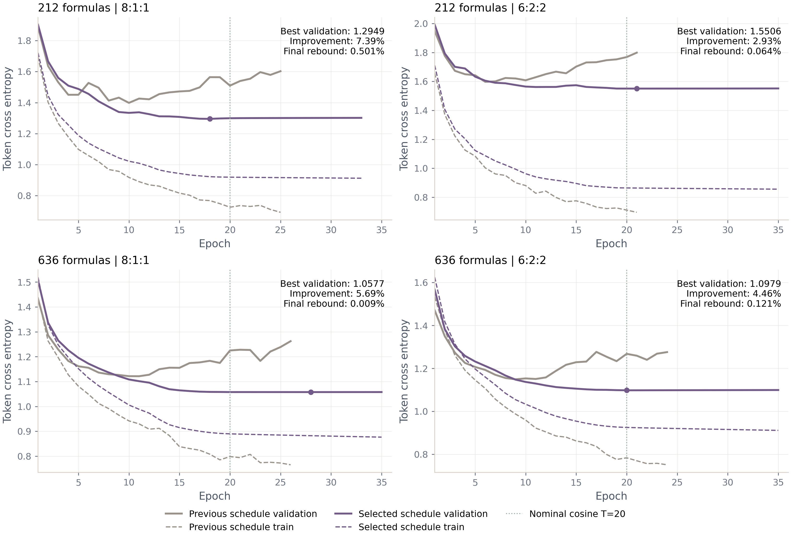

# 词表128：现有76组预训练结果分析

日期：2026-11-17。76组均正常退出。每套语料包含18组参数组合及1组旧策略对照；词表128、seed525。只使用训练及验证记录，未读取测试数据，本次未启动补充实验。

## 当前建议

212：初始学习率1e-4、矩阵L2=0.001；636：初始学习率5e-5、L2=0。两种划分下分别排名后，得到相同的规模内建议。共同采用名义余弦T=20、minimum_epochs=30、patience=15、min_delta=1e-4、max_epochs=80。真实最低验证loss检查点与早停计数分开；不取最后一轮权重。

|规模|划分|旧最佳CE|新最佳CE|相对降低|最佳/实际训练轮|旧末轮回升|新末轮回升|
|---|---|---:|---:|---:|---:|---:|---:|
|212|811|1.398236|1.294942|7.39%|18/33|14.622%|0.501%|
|212|622|1.597425|1.550598|2.93%|21/35|12.613%|0.064%|
|636|811|1.121451|1.057674|5.69%|28/35|12.559%|0.009%|
|636|622|1.149066|1.097863|4.46%|20/35|11.044%|0.121%|

回升=(最后一轮验证CE/全程最低验证CE−1)。此项衡量后段验证退化，不能代替训练—验证差距。旧策略是同一词表、同一划分、同一种子下T200/LR1e-4/L2=0的对照；不是不同语料或旧词表下的历史数值。此比较证明整套策略改良，不能将收益全部归因于某一个参数。

## 训练充分性与过拟合

四组都已实际完成33–35轮，不是因80轮上限停止；最佳点位于18/21/28/20轮。末10轮验证CE的线性斜率分别约1.18e-4、8.53e-5、8.84e-6、8.47e-5/epoch，均为平台或轻微上升，没有呈现仍明显下降却被截断。第20轮之后仍观察了13–15轮低学习率训练。636/811在第28轮出现略低的验证点，证实不能在20轮机械停止。

|规模|划分|最佳点训练CE|最佳点验证CE|绝对差值|末5轮验证范围|
|---|---|---:|---:|---:|---:|
|212|811|0.921619|1.294942|0.373323|0.000437|
|212|622|0.863415|1.550598|0.687184|0.000383|
|636|811|0.882396|1.057674|0.175278|0.000079|
|636|622|0.924803|1.097863|0.173060|0.000342|

212/622的训练—验证差距仍达0.6872，甚至大于其旧策略最佳点差距0.5944；636/622差距也由0.1617变为0.1731。因此应称“最佳验证精度改善且后段过拟合显著缓解”，不能称“已消除过拟合”或“所有差距都缩小”。验证来源公式只有21/43/63/127条，32倍增强不增加独立来源公式数；单种子无法证明统计稳定性。

## 次优结果及参数含义

|规模|划分|次优(T,LR,L2)|次优CE|相对第一名差距|
|---|---|---|---:|---:|
|212|811|30, 5e-05, 0.001|1.301699|0.522%|
|212|622|25, 0.0001, 0.001|1.554045|0.222%|
|636|811|25, 5e-05, 0|1.058158|0.046%|
|636|622|30, 0.0001, 0.001|1.099589|0.157%|

636/811的T25与T20仅差0.046%，不能宣称20周期统计显著更优。636/622的T30/LR1e-4/L2=.001也接近最优，但参数更复杂、训练更长。212两种划分均由L2=.001胜出，L2=.01普遍明显损伤验证精度；不应为了平曲线选它。

共有30组达到80轮，部分仍在缓慢改善；不能把这些组都视为充分收敛。入选四组并非这些封顶任务。636/811的T30/LR1e-4/L2=.001在80轮达到1.066386，仍比首选差约0.82%，末10轮改善仅0.0163%；延长全部封顶组的优先级较低。

## 早停回放

对每套前三名的已观察轨迹回放minimum_epochs20/25/30、patience5/10/15、min_delta1e-5/1e-4。对四个首选，minimum_epochs30、min_delta1e-4、patience10都保留原最低验证CE，训练会在30轮停止；原patience15实际33–35轮。此为同一既有轨迹的回放，不是独立新实验证据，也不证明对96/160适用。因此当前仍建议patience15，优先保证足够观察时间。

## 代码审计发现：需要在后续确认

1. 实际代码仅在epoch<T时scheduler.step()，使T20从第20轮起固定在退火索引19，未到eta_min。212实际平台LR=1.60942714e-6；636=1.30163566e-6，而不是宣称的1e-6。本次入选结果对应这些实际轨迹。正确到达T终点后保持1e-6会轻微改变轨迹，不能静默修改后声称复现原实验。T25/T30同样少走一次调度。
2. epoch开头检查早停使用即将开始的epoch，minimum_epochs30有时在第30轮开始前退出，实际只完成29轮；COMPLETE却记为30轮。76组中14组存在这一元数据差异。入选四组及四个旧对照无此差异。未修改历史结果，应以training.json历史长度为准。

建议将早停只放在每轮训练/验证结束之后，停止轮数写入最后完成epoch；调度改为完成第T轮后到达eta_min，此后固定。此处只提出修复方案，未改服务器历史代码、未开启新任务。

## 可选补充实验（等待用户决定）

优先建议12组：四套首选各在seed525做一次调度/早停边界修正后的完整运行（4组），再各以seed526/527运行（8组）。沿用名义T20、原LR/L2、minimum_epochs30、patience15/max80。以此检查改良是否跨种子成立，并给未来96/160提供清楚且一致的实现。前4组是实现校正验证，不计为新参数带来性能改进。

若还想继续挖掘超参数，可另做8组局部扫描：212两种划分保持T20/LR1e-4，L2改为0.0005/0.002（4组）；636两种划分保持T20/L2=0，LR改为2.5e-5/7.5e-5（4组）。这些是可选探索，不承诺更优；优先级低于复验与实现校正。无需重做大网格。

## 后续96/160的选择口径

用户决定是否补充128实验后，再将两套规模内参数分别应用于96/160及两种划分。对不同词表不能直接比较token CE大小：token单位不同。应在相同验证公式上比较nats/byte（统一EOS与字节口径）、训练/验证曲线及后段回升，分别与各词表旧策略对照，最终再按212/636各自选出适合三词表的共享参数或说明必要的例外。当前只有128的网格数据，不宣称参数已对96/160最优。

文件：all_runs.csv记录所有76组；selection_analysis.json记录首选、次优、封顶组、元数据异常和早停回放；records/保存服务器原始JSON及源码；provenance.json记录快照SHA256。