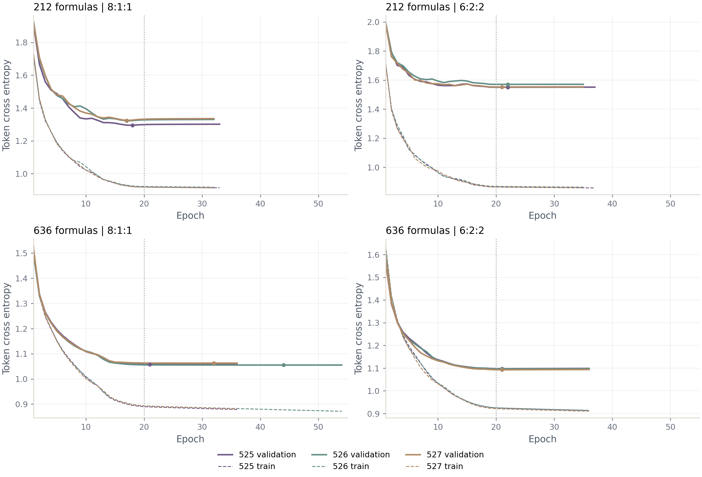

# 词表128：12组确认实验结论

2026-11-17。12/12运行完成，无失败。对全部训练历史逐轮核验：实际完成轮数与COMPLETE一致、最佳轮与最低CE一致、损失有限、从第21轮起LR=1e-6、停止时有效改善等待计数达到15且未达到80轮上限。未启动96/160或新的探索实验。

## 建议

词表128的当前候选配置通过实现修正及三种子稳定性检查，可以作为96/160的起始配置。212采用LR1e-4、矩阵L2=.001；636采用LR5e-5、L2=0；两种语料划分保持独立训练。通用T20、eta_min1e-6、最少实际30轮、patience15、delta1e-4、最大80轮、Adam、batch128、clip1。保存真实最低验证CE检查点，微小改善也保存，但不必重置patience。

|规模|划分|最佳CE均值±样本SD|最佳NPB均值±样本SD|停止轮数|最大末轮回升|
|---|---|---:|---:|---:|---:|
|212|811|1.31414 ± 0.01665|0.48682 ± 0.00617|32–33|0.832%|
|212|622|1.55777 ± 0.01096|0.50929 ± 0.00358|35–37|0.042%|
|636|811|1.05855 ± 0.00393|0.33520 ± 0.00124|36–54|0.011%|
|636|622|1.09569 ± 0.00269|0.35333 ± 0.00087|36–36|0.120%|

NPB为验证序列含EOS的累积NLL除以对应渲染LaTeX UTF8字节数（不含控制符字节）；不同词表采用完全相同验证公式、增强和EOS口径才可横向比较。

## 对旧策略的改善是否保留

|规模|划分|旧策略seed525最佳CE|修正版seed525最佳CE|同种子相对改善|
|---|---|---:|---:|---:|
|212|622|1.597425|1.550508|2.94%|
|212|811|1.398236|1.294942|7.39%|
|636|622|1.149066|1.097676|4.47%|
|636|811|1.121451|1.057614|5.69%|

修正相对原首选seed525的最佳CE变化分别为212/811 0%、212/622 −0.0058%、636/811 −0.0056%、636/622 −0.0170%，没有性能退化。三种子的新配置最佳CE均低于相应旧策略seed525对照；旧策略没有526/527对照，不能称为三种子配对比较。

## 训练充分性

全部运行完成32–54轮，没有80轮截断。末10轮验证CE均已接近平台；11组微升，幅度约0.0035%–0.119%，636/811 seed527微降约0.00215%。

636/811 seed526：第20轮CE1.055837，第30轮1.055386，第44轮最低1.055165，第54轮1.055278。第20至44轮仅再改善约0.064%，但确有缓慢改善，并观察了最佳点后10轮。累计有效改善计数决定停止，因此停止轮不必等于最低点+patience。636/811 seed527最佳点在32轮，之后改善不足delta，36轮停止符合规则。

## 过拟合与限制

12组停止时验证CE回升均小于0.84%；212/811约0.51%–0.83%，其余三套均不超过0.12%。后段退化较轻。训练—验证差距仍存在：212/811为0.373–0.399；212/622为0.687–0.703；636/811为0.169–0.179；636/622为0.172–0.174。尤其212/622不能说泛化差距已消除。验证集来源公式数分别为21、43、63、127，增强不会增加独立公式数。

三种子复验的是已选参数，不是所有候选参数；能支持跨种子稳定和后段平稳，不能证明全参数空间最优或T20显著优于T25。旧策略对照仅与seed525配对。

## 后续

建议不扩展128网格，进入96/160。每个词表沿用修正版实现、相同冻结划分和两套规模参数，每词表4套语料×3种子=12组。比较统一NPB、曲线末段、最佳点和训练—验证差距；若某词表过拟合明显、验证表现不及自身旧策略，或80轮仍改善，再局部调参。若要断言相对旧策略有改良，96/160也需各自旧策略对照，不能从128外推。当前尚未启动。

逐运行数据见per_run_analysis.csv；重算脚本analyze_confirmation.py；原始JSON与下载指纹保存在records/和provenance.json。