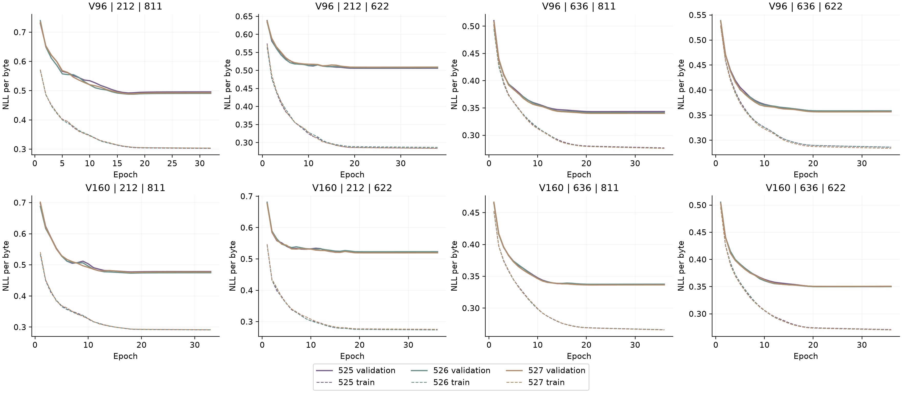

# 三词表预训练参数最终复核

2026-11-17。96/160本轮32组全部完成；自动分析退出码0。连同128的12组确认，复核44组记录，其中36组新配置及本轮8组seed525旧策略对照。12组参数网格条件（三词表×两规模×两划分）各有三个种子。

## 最终建议

96、128、160共用按语料规模区分的两套参数，不为划分或词表新增超参数例外。212用LR1e-4、矩阵L2=.001；636用LR5e-5、L2=0。共同Adam、6层、batch128、clip1、T20、eta_min1e-6、最低实际30轮、patience15、delta1e-4、max80。bias/一维参数不衰减。完成第20轮后调度到最低LR，自第21轮保持；保存真实最低验证CE权重，有效改善参考值与检查点分别管理。位置至少72，636/811/v96为73。

结论是这套共享策略在现有验证上适用且比旧策略改善，不是每词表独立大网格后的全局最优，也不是已证明下游PDE发现更好。不修改旧记录，不自动新增实验。参数已保存final_pretraining_config.json。

## 审计结果

44组的实际history长度、COMPLETE轮数、最佳epoch和最低CE均吻合；训练和验证损失有限。36组新配置全部达到至少30轮且正常早停，没有80轮截断；从第21轮起均保持1e-6，patience参考规则逐轮回放通过。三个词表相同规模/划分下验证NPB字节分母一致。数据增强与EOS口径相同，因此可跨词表比较NPB；不使用token CE直接排名。未读测试数据。

## 与自身旧策略的同种子比较

|词表|规模|划分|最佳验证CE相对降低|新策略最大后段回升（三种子）|
|---|---|---|---:|
|96|212|811|10.40%|0.758%|
|160|212|811|5.80%|0.291%|
|96|212|622|2.49%|0.047%|
|160|212|622|1.89%|0.046%|
|96|636|811|4.80%|0.049%|
|160|636|811|3.66%|0.066%|
|96|636|622|6.83%|0.029%|
|160|636|622|4.60%|0.079%|

96/160八套seed525配对对照全部改善，幅度1.89%–10.40%；旧策略停止时回升7.62%–18.85%，新策略全部种子回升不超过0.759%。128已完成同口径确认，其seed525配对改善2.94%–7.39%。旧策略只有525，不能把三种子新策略复验写成三种子配对优越性或显著性结论。

## 三词表统一字节口径验证

|规模|划分|词表|验证NPB均值±样本SD|停止轮数|最大后段回升|
|---|---|---:|---|---|---:|
|212|811|96|0.48968 ± 0.00228|32–32|0.758%|
|212|811|128|0.48682 ± 0.00617|32–33|0.832%|
|212|811|160|0.47537 ± 0.00209|33–33|0.291%|
|212|622|96|0.50749 ± 0.00154|38–38|0.047%|
|212|622|128|0.50929 ± 0.00358|35–37|0.042%|
|212|622|160|0.52123 ± 0.00182|36–36|0.046%|
|636|811|96|0.34161 ± 0.00163|36–36|0.049%|
|636|811|128|0.33520 ± 0.00124|36–54|0.011%|
|636|811|160|0.33698 ± 0.00064|36–36|0.066%|
|636|622|96|0.35791 ± 0.00111|36–36|0.029%|
|636|622|128|0.35333 ± 0.00087|36–36|0.120%|
|636|622|160|0.35017 ± 0.00033|36–36|0.079%|

NPB越低越好。212/811的160均值最低，212/622的96最低（与128相近），636/811的128最低，636/622的160最低。不同条件偏好不同，不存在一档词表在四套语料上全面占优。全部三词表继续保留以便后续发现实验；预训练NPB优劣不能替代下游结构恢复指标。三种子样本量有限，均值差不等于统计显著差。

## 训练充分性和过拟合

36组新配置实际完成32–54轮，均未被80轮上限截断。96/160的最佳点在17–24轮，之后观察足够低LR轮数，末10轮验证变化均在极小范围（最大上升约0.092%）；128包括44轮最佳点的情况，也已确认后段接近平台。没有因换词表而出现明显未收敛或持续验证恶化的证据。

但平曲线不是训练—验证完全一致。采用更可比的NPB差值，212/622的最佳点验证减训练均值分别约0.2210/0.2307/0.2455（词表96/128/160）。160在这个划分上的泛化差距最大，且验证NPB较96高约2.71%，需要作为下游解释的限制保留。目前仍优于其自身旧策略，强L2=.01在128网格损伤精度，因此没有充分证据为此单独更改160参数或继续压低训练能力。

## 后续安排

建议停止本轮预训练调参，将两套规模参数作为三个词表的正式实验参数。8:1:1/6:2:2独立运行、各自冻结自己的词表及最佳权重。若后续改变语料或生成长度，需重新检查位置上限和收敛。测试集尚未用于本轮选择；未启动新的PDE发现/SFT或测试评价。

复核脚本final_review.py；机器检查review_checks.json；三词表汇总three_vocab_review.csv；原始JSON records/；配置final_pretraining_config.json。启动时两组编译竞态已修复并重试，失败前没有训练历史，最终32组均返回0，修复记录startup_repair.json。